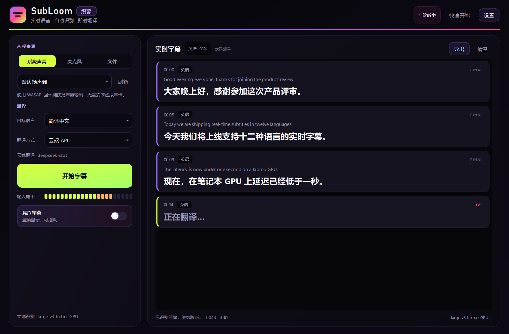
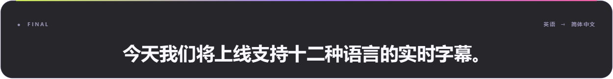

# SubLoom · 织幕

**跨平台实时语音翻译字幕。** 捕获系统声音、麦克风或媒体文件，自动识别语言，翻译成你指定的语言，并以置顶悬浮字幕显示。

识别在本机完成；翻译优先走云端 LLM，断网或失败时自动回退到本地 NLLB。代码与模型分离，仓库只保留源码。





> 当前为 `0.1.0` alpha。Windows 已实测系统声音回环、GPU 识别、本地翻译和文件字幕流程；macOS 系统声音需要 BlackHole（见下文）。

---

## 功能

- **三种输入**：Windows 系统声音（WASAPI 回环）、麦克风、本地音视频文件。
- **自动识别语言**：Whisper 自动检测，短句不会频繁跳变；也可手动锁定源语言。
- **50 种目标语言**：中、英、日、韩、西、法、德、俄、阿、印地、泰、越等，界面可切换。
- **混合翻译**：OpenAI 兼容的云端接口优先，失败时自动切换本地 NLLB-200；也可强制纯离线。
- **翻译加速**：局部译文缓存、重复请求合并、慢请求快速失败；定稿先立即显示局部译文，随后带上下文修正。
- **中英双语界面**：设置 → 界面，可切换简体中文 / English，重启后生效。
- **实时字幕**：说话过程中约每 650ms 刷新局部结果；停顿约 450ms 后定稿并高质量翻译。悬浮窗默认只显示译文，不会把尚未翻译的原文当作字幕。
- **置顶悬浮窗**：透明背景、可拖动、字号/透明度可调、鼠标穿透、右键快捷菜单。
- **字幕导出**：译文 SRT、双语 SRT、纯文本。
- **隐私**：音频不上传；云端翻译只发送识别后的文本。API Key 保存在系统钥匙串。
- **仓库友好**：模型权重、构建产物、录音都不进入 Git；首次使用时下载到用户数据目录。

## 适合什么场景

会议、网课、直播、视频复盘、跨语言沟通，以及需要把字幕叠在其他窗口上的场景。

它追求的是**低延迟的辅助字幕**，不是会议同传级别的专业翻译。重要场合请保留人工校对。

---

## 快速开始

### 环境要求

| 项目 | 要求 |
| --- | --- |
| 系统 | Windows 10/11；macOS 13+（系统声音需额外配置） |
| Python | 3.10 – 3.12（推荐 3.12；3.13 未经完整测试） |
| 显卡 | 可选。NVIDIA GPU 可显著加速；CPU 可运行小模型 |
| 网络 | 云端翻译需要；本地模式可离线 |
| ffmpeg | **不需要**，文件解码使用内置 PyAV |

### 安装（Windows）

```powershell
git clone https://github.com/Seapeak19/Real-time-Voice-Recognition-Subtitles.git
cd Real-time-Voice-Recognition-Subtitles
python -m venv .venv
.\.venv\Scripts\Activate.ps1
python -m pip install --upgrade pip

# CPU 版本
python -m pip install -e .

# 或者：Windows NVIDIA GPU 版本（会额外下载约 1.3GB CUDA 运行库）
python -m pip install -e ".[gpu]"
```

> 如果克隆到自定义目录，把命令中的 `Real-time-Voice-Recognition-Subtitles` 换成你的目录名即可。

### 安装（macOS）

```bash
git clone https://github.com/Seapeak19/Real-time-Voice-Recognition-Subtitles.git
cd Real-time-Voice-Recognition-Subtitles
python3.12 -m venv .venv
source .venv/bin/activate
python -m pip install --upgrade pip
python -m pip install -e .
```

macOS 的系统声音需要 BlackHole 或多输出设备，步骤见 [docs/macos-audio.md](docs/macos-audio.md)。麦克风和文件模式开箱即用。

### 运行

```bash
subloom
# 如果命令行入口不可用：
python -m subloom
```

首次开始字幕时会自动下载识别模型：

- GPU 自动选择 `large-v3-turbo`（约 1.6GB）
- CPU 自动选择 `small`（约 484MB）
- 也可以在 **设置 → 识别 → 预下载** 提前下载，或用 CLI：

```bash
python scripts/download_models.py --all
```

模型默认存放在：

- Windows：`%LOCALAPPDATA%\SubLoom\models`
- macOS：`~/Library/Application Support/SubLoom/models`

也可以用 `SUBLOOM_MODEL_DIR` 指定目录。

---

## 配置翻译

启动后点击 **设置 → 翻译**。

### 云端翻译（推荐，准确率更高）

支持任意 **OpenAI Chat Completions 兼容**接口：

| 配置 | 示例 |
| --- | --- |
| API 地址 | `https://api.deepseek.com/v1` |
| 模型 | `deepseek-chat` |
| API Key | `sk-...` |

也适用于 OpenAI、OpenRouter、硅基流动、Azure OpenAI 兼容层，以及本地 Ollama / LM Studio 的 OpenAI 兼容接口。Ollama 不校验 Key 时，可随便填一个非空字符串（例如 `ollama`）。

| 服务 | API 地址 | 模型示例 |
| --- | --- | --- |
| DeepSeek | `https://api.deepseek.com/v1` | `deepseek-chat` |
| OpenAI | `https://api.openai.com/v1` | `gpt-4o-mini` |
| OpenRouter | `https://openrouter.ai/api/v1` | 服务商页面上的模型 ID |
| Ollama | `http://127.0.0.1:11434/v1` | `llama3.1` |
| LM Studio | `http://127.0.0.1:1234/v1` | 已加载的模型名 |

建议使用低延迟的 chat 模型，不要使用会先输出大段推理过程的 reasoner 模型；字幕翻译要的是短输出。

Key 的保存优先级：

1. 环境变量 `SUBLOOM_API_KEY`（最高，适合 CI / 临时使用）
2. 系统钥匙串（Windows Credential Manager / macOS Keychain）
3. 设置界面的输入框（写入钥匙串）

```powershell
$env:SUBLOOM_API_KEY = "sk-..."
subloom
```

点击 **测试云端翻译** 可以确认地址、模型和 Key 是否可用。

> 云端只接收识别后的文本，不上传音频。具体隐私政策取决于你选择的服务商。

### 本地翻译（离线兜底）

在 **设置 → 翻译 → 本地翻译** 中点击下载：

- 模型：NLLB-200 distilled 600M，CTranslate2 INT8，约 650MB
- 下载后保存在用户数据目录，不进入 Git 仓库
- 识别和翻译都可以完全离线运行

**许可提醒**：NLLB-200 模型使用 **CC BY-NC 4.0** 许可，仅限非商业用途。需要商业使用时，请使用云端翻译或替换成本地翻译后端。详见 [NOTICE.md](NOTICE.md)。

### 自动 / 云端 / 本地 / 仅原文

- **自动**：有云端 Key 用云端；没有 Key 但有本地模型用本地。
- **云端**：强制云端；失败时若本地模型存在会自动兜底。
- **本地**：完全离线。
- **仅原文**：只识别不翻译。

### 界面语言

**设置 → 界面 → 界面语言** 支持：

- 简体中文
- English

选择后保存，关闭并重新打开 SubLoom 生效。字幕目标语言是独立设置，不会被界面语言影响。

---

## 使用方法

1. 选择音频来源。
   - **系统声音**：Windows 选择默认扬声器或具体回环设备；macOS 选择 BlackHole。
   - **麦克风**：选择输入设备。
   - **文件**：选择音频/视频，按原速播放并生成字幕。
2. 选择目标语言和翻译方式。
3. 点击 **开始字幕**。
4. 打开悬浮字幕窗（默认开启），拖动到合适位置。悬浮窗默认只显示译文；如果想同时看原文，在 **设置 → 字幕 → 同时显示原文** 中打开。
5. 结束后点击 **导出**，保存译文 SRT、双语 SRT 或纯文本。

### 快捷键 / 交互

- 拖动悬浮字幕窗可移动位置，位置会自动保存。
- 右键悬浮字幕窗：增大/减小字号、打开设置、隐藏。
- 设置中可开启鼠标穿透；开启后需从主界面关闭。
- 主界面 **清空** 只清空当前会话，已导出的文件不受影响。

---

## 性能与延迟

实际延迟取决于模型、GPU、语言对和云端服务：

| 阶段 | 典型耗时 |
| --- | --- |
| 局部识别（GPU, large-v3-turbo） | 0.3 – 0.8 秒 |
| 局部识别（CPU, small） | 0.5 – 2 秒 |
| 本地 NLLB 翻译 | 0.05 – 0.3 秒 |
| 云端 LLM 翻译 | 0.4 – 2 秒 |
| 断句静音等待 | 0.45 秒（可调） |
| 从停顿到最终译文 | 1 – 2.5 秒（GPU） |

在 RTX 4060 Laptop（8GB）上实测：`large-v3-turbo` 处理 7 秒英文音频约 0.6 秒；本地 NLLB 单句约 0.1 秒；首次启动加载两个模型约 3–4 秒。CPU 或云端网络较慢时延迟会明显增加。

字幕会先显示“正在翻译…”，译文到达后替换；不会再把原文当成译文字幕显示。主界面卡片仍可选择显示原文小字。想更实时，可以：

- 使用 NVIDIA GPU 和 `large-v3-turbo`
- 缩短 **断句静音**
- 开启 **局部翻译**
- 使用低延迟的云端模型

“快”和“准”本身是取舍：局部结果使用 `beam_size=1`，定稿使用更大的 beam；云端翻译会携带最近几句上下文，准确率更高但比本地慢。

---

## 工作原理

```text
系统声音 / 麦克风 / 文件
          │
          ▼
   16 kHz 单声道重采样
          │
          ▼
   WebRTC VAD 语音分段
     │ partial        │ final
     ▼                ▼
 faster-whisper   faster-whisper
 (beam=1, 快)     (beam=3, 准)
     │                │
     └──────┬─────────┘
            ▼
     语言自动检测 / 锁定
            ▼
   TranslationService
   云端 LLM → 本地 NLLB 兜底
            ▼
  主界面字幕卡片 + 置顶悬浮窗 + SRT
```

更详细的设计见 [docs/architecture.md](docs/architecture.md)。

### 为什么识别本地、翻译云端？

- 音频留在本机，隐私更好，也不受云端 ASR 流式接口限制。
- Whisper large-v3-turbo 在 8GB 显卡上已经足够快，且支持 99 种语言自动检测。
- 翻译是准确率的瓶颈：LLM 在上下文、术语、语气上明显强于 600M 的本地模型，所以云端优先、本地兜底。

---

## GitHub 仓库与模型分发

这个项目刻意保持仓库很小：

- `.gitignore` 排除 `.venv/`、`models/`、`dist/`、`samples/`、日志和本地数据。
- 模型权重不提交。首次使用时下载到用户数据目录。
- GitHub Release 只放安装包，不放模型；安装包也不包含模型。
- 单文件控制在 GitHub 的 100MB 限制内；需要大文件时用 Release（单文件上限 2GB），不要用 LFS 存模型。

构建安装包：

```powershell
# CPU 版本
.\packaging\build.ps1

# Windows GPU 版本（包含 CUDA 运行库，安装包会大很多）
.\packaging\build.ps1 -Gpu
```

产物在 `dist\SubLoom`。GitHub Actions 的 `release.yml` 会在打 `v*` tag 时自动构建 Windows/macOS 包并创建 Release。

---

## 开发

```bash
python -m pip install -e ".[dev]"
python -m pytest -q
python -m ruff check src tests scripts
python -m subloom --smoke-test
```

生成 README 截图：

```bash
python scripts/make_screenshot.py
```

检查 GPU / CUDA 状态：

```bash
python scripts/check_gpu.py
```

### 项目结构

```text
src/subloom/
  audio/        捕获、重采样、VAD
  asr/          faster-whisper、语言锁定、CUDA 运行库
  translate/    云端 OpenAI 兼容接口、本地 NLLB、回退策略
  pipeline.py   捕获 → 分段 → 识别 → 翻译 的实时流水线
  ui/           PySide6 主界面、悬浮窗、设置
  subtitles.py  SRT / 文本导出
tests/          单元测试与 UI 测试
packaging/      PyInstaller 配方与构建脚本
docs/           架构、macOS 音频、故障排查
```

---

## 已知限制

- macOS 系统声音依赖 BlackHole，尚未内置 ScreenCaptureKit。
- 目前只有本地 ASR，没有云端流式 ASR 适配器。
- 本地 NLLB 为 600M 模型，质量低于云端 LLM；专有名词和长句可能出错。
- 说话人分离、OBS 浏览器源、术语表、Linux 官方支持尚未实现。
- 安装包未做代码签名；macOS 首次打开需右键 → 打开。
- 这是辅助字幕工具，不应用于医疗、法律等高风险场景的正式翻译。

## 故障排查

先看 [docs/troubleshooting.md](docs/troubleshooting.md)。最常见的两个问题：

**`cublas64_12.dll is not found`**

先确认你运行的是哪一个版本：

- **`dist\SubLoom\SubLoom.exe`（CPU 安装包）不包含 CUDA 运行库**。它无法通过 pip 补装，请改用 GPU 版安装包，或直接使用源码版：
  ```powershell
  .\.venv\Scripts\python.exe -m subloom
  ```
- **源码版**才按下面的方式补装 CUDA 依赖：
  ```powershell
  .\.venv\Scripts\Activate.ps1
  python -m pip install -e ".[gpu]"
  ```
  安装后重启应用。仅安装 `ctranslate2` 不会自动带 CUDA 运行库。

如果你暂时只想先跑起来，在 **设置 → 识别 → 计算设备** 里改为“自动”或“CPU”，保存后再开始字幕。

**macOS 没有系统声音**

安装 BlackHole 并创建多输出设备，然后在 SubLoom 中选择 BlackHole。步骤见 [docs/macos-audio.md](docs/macos-audio.md)。

---

## 路线图

- macOS 原生 ScreenCaptureKit 系统音频
- 云端流式 ASR（Deepgram / Azure / OpenAI Realtime）
- 术语表与专有名词替换
- 翻译流式输出与 OBS 浏览器源
- 说话人分离、双语字幕样式
- Linux（PipeWire monitor）

欢迎提 Issue 或 PR。

## 许可

- 本项目代码：**MIT**，见 [LICENSE](LICENSE)。
- faster-whisper：MIT；Whisper 模型权重：MIT。
- NLLB-200 distilled 600M：**CC BY-NC 4.0**，模型单独下载，不随仓库分发。
- PySide6 / Qt：LGPLv3（动态链接）。
- 其他第三方组件见 [NOTICE.md](NOTICE.md)。

如果你要商业使用，请先确认本地翻译模型的非商业限制，或只使用云端翻译。
